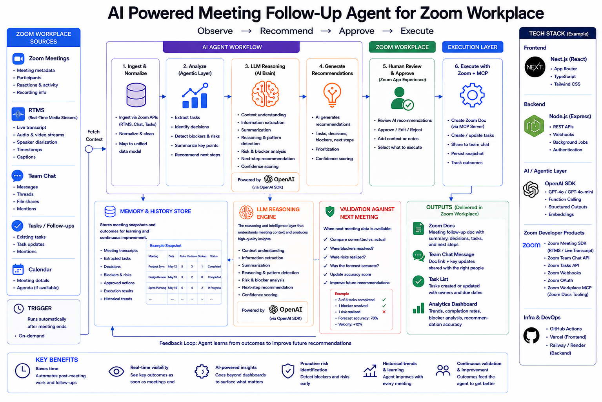

# Human-in-the-Loop Zoom Workplace Agent

> An AI meeting assistant for Zoom Workplace that listens to live meetings, recommends follow-up actions, and only executes them after a human approves.


---

## Overview

Meetings generate decisions, action items and risks, but most of them get lost once the call ends. This project turns a Zoom meeting into a structured, reviewable workflow:

1. **Observe** – Live transcripts stream in through Zoom RTMS (Real-Time Media Streams).
2. **Recommend** – AI extracts tasks, decisions, risks and a summary, and suggests follow-up actions.
3. **Approve** – Every suggestion lands in a review queue where the user can approve, edit or reject it.
4. **Execute** – Approved actions run: tasks are created (optionally synced to Zoom Tasks), follow-up docs are written to Zoom Docs through Zoom MCP, and updates are posted to Team Chat.

**The AI never changes state on its own.** Every write is gated behind an explicit human click.



---

## Features

- **Live meeting transcription** – RTMS transcript segments are streamed to the dashboard over Server-Sent Events in real time.
- **Automatic task completion detection** – A keyword matcher marks obvious tasks done as they're mentioned ("I just sent the deck").
- **Post-meeting AI analysis** – Suggested tasks, a summary, key decisions and risks are generated when the meeting ends.
- **Approval queue** – Review, edit, approve or reject each AI suggestion before it becomes a real task.
- **AI Actions** – Proactive recommendations such as *Create Meeting Follow-up Doc*, with a plain-language "why" for each one.
- **Zoom Docs via MCP** – Approved follow-up documents are created in Zoom Docs using the OpenAI Responses API with Zoom MCP as a remote tool.
- **Team Chat bot** – A *Research Assistant* and a multi-step *Create Task* flow, plus threaded notifications for new suggestions.
- **In-meeting Zoom App** – Start, stop, pause and resume RTMS from inside the Zoom client.
- **Two sign-in paths** – In-client OAuth (PKCE) inside Zoom and redirect OAuth in the browser, both sharing the same session.
- **Zoom for Government support** – Point the app at ZfG endpoints with two environment variables.
- **Graceful degradation** – With no AI key configured, the app runs on seed data.

---

## Tech Stack

| Layer | Technology | Purpose |
|---|---|---|
| Frontend | **Next.js 16, React 18, TypeScript, Tailwind CSS** | Dashboard, meeting pages, suggestion review and AI Actions UI |
| Backend | **Node.js, Express 5** | Webhooks, OAuth, RTMS ingestion, AI orchestration, REST API |
| Real-time | **Zoom RTMS, WebSockets, SSE** | Live transcript capture and streaming to the browser |
| In-meeting app | **Zoom Apps SDK** | RTMS controls, in-client OAuth, `sendMessageToChat` |
| Messaging | **Zoom Team Chat Bot** | Chat-driven task creation, research and notifications |
| AI | **OpenAI SDK, Anthropic API** | Transcript analysis, summaries, follow-up docs, research replies |
| Integrations | **Zoom MCP, Zoom Tasks API** | Creating Zoom Docs and syncing approved tasks |

---

## Project Structure

```
.
├── 0-app-manifest/          # Zoom Marketplace app manifest + setup notes
├── assets/                  # Architecture diagram
├── backend/
│   ├── server.js            # Express entry point
│   ├── routes/              # OAuth, webhooks, RTMS, signatures, REST API (routes/api)
│   ├── data/seed/           # Demo meetings, transcripts, suggestions, activity
│   └── utils/
│       ├── ai/              # Task analyzer, summary generator, follow-up agents
│       ├── rtms/            # RTMS service, transcript store, SSE + WebSocket services
│       ├── zoom/            # Zoom API, OAuth, Tasks, MCP helpers
│       ├── cards/           # Team Chat message cards
│       ├── handlers/        # Chat bot action routing and flows
│       ├── meeting-tasks/   # Task store and transcript-to-task matcher
│       └── store/           # In-memory state, task, analytics and doc stores
├── frontend/
│   ├── app/                 # Next.js routes: /, /meetings, /live, /suggestions, /tasks, ...
│   ├── components/          # AppShell, Tabs, Cards, AI Actions, RTMS controls
│   └── lib/                 # API client, Zoom Apps SDK hook, shared types
├── .env.example
└── package.json             # Root scripts that run backend + frontend together
```

---

## Getting Started

### Prerequisites

- **Node.js v20.3+** (needed by the `@zoom/rtms` native binding)
- A [Zoom Developer account](https://developers.zoom.us) with **RTMS enabled**
- A **General OAuth App** in the [Zoom App Marketplace](https://marketplace.zoom.us/) with:
  - Team Chat Subscription (for the bot)
  - Event Subscriptions for `meeting.rtms_started` and `meeting.rtms_stopped`
  - The RTMS feature enabled
  - Scopes: `imchat:userapp`, `meeting:read:meeting_audio`, `meeting:read:meeting_video`, `meeting:read:meeting_transcript`, `meeting:read:meeting_chat`, `zoomapp:inmeeting`, `docs:write:import`
  - In-client APIs: `startRTMS`, `stopRTMS`, `pauseRTMS`, `resumeRTMS`, `getRTMSStatus`, `onRTMSStatusChange`, `getRunningContext`, `getMeetingContext`, `authorize`, `onAuthorized`
- [ngrok](https://ngrok.com) (a free static domain is recommended)
- An [OpenAI API key](https://platform.openai.com/api-keys) (optional, the app falls back to seed data without one)

See [`0-app-manifest/README.md`](0-app-manifest/README.md) to create the Marketplace app from a manifest.

### Installation

```bash
git clone https://github.com/Sanketmis208/human-in-llop-zoom.git
cd human-in-llop-zoom
npm run install:all
cp .env.example .env
```

### Configuration

1. Start a tunnel to the Next.js app (port 3000):
   ```bash
   ngrok http 3000
   ```
2. Fill in `.env` with your Zoom credentials and ngrok URL (see [Environment Variables](#environment-variables)).
3. In the Zoom Marketplace, point all URLs at the same ngrok host:

   | Setting | Value |
   |---|---|
   | Home URL | `https://<your-ngrok>.ngrok.app/` |
   | Webhook Endpoint URL | `https://<your-ngrok>.ngrok.app/webhooks` |
   | OAuth Redirect URL | `https://<your-ngrok>.ngrok.app/auth/callback` |
   | OAuth Allow List | Add the Home URL as well (needed for in-client OAuth) |

4. Enable **In-Client OAuth** under *Features*.

### Run

```bash
npm run dev:all
```

This starts Express on port `4000` and Next.js on port `3000`. Open your ngrok URL to see the dashboard, or open the app from the **Apps** panel inside a Zoom meeting to use the RTMS controls.

| Script | Description |
|---|---|
| `npm run install:all` | Install root, backend and frontend dependencies |
| `npm run dev:all` | Run backend and frontend together |
| `npm run dev:backend` | Run only the Express backend |
| `npm run dev:frontend` | Run only the Next.js frontend |
| `npm start` | Start the backend in production mode |

---

## Environment Variables

A single `.env` file at the project root is shared by the backend and the frontend.

| Variable | Required | Description |
|---|---|---|
| `ZOOM_CLIENT_ID` | Yes | OAuth Client ID |
| `ZOOM_CLIENT_SECRET` | Yes | OAuth Client Secret |
| `ZOOM_ACCOUNT_ID` | Yes | Zoom Account ID |
| `ZOOM_BOT_JID` | Yes | Bot JID from the Team Chat Subscription |
| `ZOOM_VERIFICATION_TOKEN` | Yes | Team Chat Subscription secret token |
| `ZOOM_REDIRECT_URI` | Yes | Must match the Marketplace OAuth redirect URI |
| `FRONTEND_PUBLIC_URL` | Yes (prod) | Public URL of the Next.js app (your ngrok host) |
| `OPENAI_API_KEY` | No | Enables AI analysis and the follow-up doc flow. Without it, the app runs on seed data |
| `ZOOM_MCP_ENDPOINT` | No | Zoom MCP endpoint. Default: `https://mcp.zoom.us/mcp/zoom/streamable` |
| `ANTHROPIC_API_KEY` | For Research Assistant | API key for the Team Chat Research Assistant |
| `ANTHROPIC_MODEL` | No | Model used by the Research Assistant |
| `ZOOM_API_BASE_URL` | No | Default `https://api.zoom.us/v2`. Use `https://api.zoomgov.com/v2` for Zoom for Government |
| `ZOOM_OAUTH_BASE_URL` | No | Default `https://zoom.us`. Use `https://zoomgov.com` for Zoom for Government |

> **Never commit `.env`.** It's already in `.gitignore`. In deployed environments, load secrets from a managed secrets store.

---

## How It Works

### Meeting lifecycle

```
BEFORE   Dashboard shows open tasks, pending approvals and recent summaries
DURING   Start RTMS in the meeting → transcript streams live to /meetings/<id>/live
         Keyword matcher auto-completes tasks as they're mentioned
AFTER    meeting.rtms_stopped → AI extracts tasks, summary, decisions and risks
         Team Chat gets a threaded "N task suggestions detected" update
REVIEW   /suggestions → approve, edit or reject each suggestion
         Approved → task created locally (+ optional Zoom Tasks sync)
```

### AI Action: Create Meeting Follow-up Doc

| Step | What happens |
|---|---|
| **Observe** | Looks at the meeting's approved tasks, pending suggestions, decisions, blockers and summary |
| **Recommend** | Shows a *Create Meeting Follow-up Doc* card with the reasons behind it |
| **Approve** | *Preview Document* generates editable Markdown. The user reviews and edits it |
| **Execute** | *Approve & create Zoom Doc* calls the OpenAI Responses API with Zoom MCP as a remote tool to create the doc |
| **Share** | *Share to Zoom Chat* posts the link to the current chat via `sendMessageToChat` |

### Team Chat bot

| Flow | Trigger | Description |
|---|---|---|
| **Research Assistant** | `menu` → *Research Assistant* | Ask a question and get an AI-drafted answer in the thread |
| **Create Task** | `menu` → *Create Task* | Multi-step form to create a task |

Commands: `menu`, `help`, `start`, `services` open the menu. `cancel`, `stop`, `quit`, `exit` end a flow.

---

## Zoom for Government

Set both overrides and register the app on `marketplace.zoomgov.com`:

```bash
ZOOM_API_BASE_URL=https://api.zoomgov.com/v2
ZOOM_OAUTH_BASE_URL=https://zoomgov.com
```

No code changes are required.

---

## Roadmap

- [ ] Persist tasks, suggestions and sessions in a database (Postgres / Redis)
- [ ] Store OAuth tokens encrypted, with refresh-token rotation
- [ ] Move webhook processing to a queue with retries and idempotency
- [ ] Add retry/backoff on outbound API calls and rate limiting on inbound routes
- [ ] AI-based matching of transcript segments to existing tasks
- [ ] Automated tests and CI

---

## Author

**Sanket Mistry**

- GitHub: [@Sanketmis208](https://github.com/Sanketmis208)

If you find this project useful, consider giving it a star.

---

## License

This project is released under the MIT License. See [LICENSE.md](LICENSE.md) for details.
